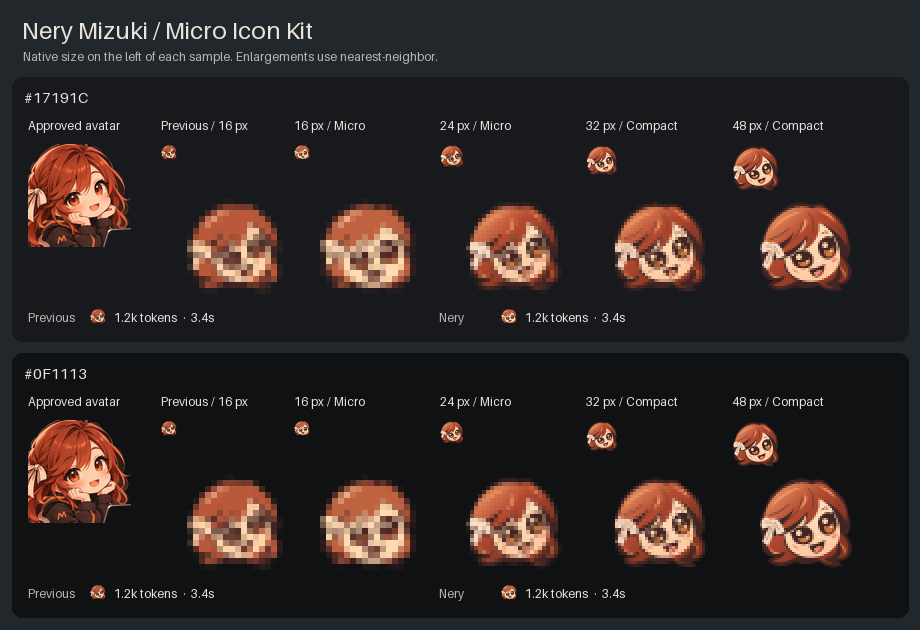

# Nery Mizuki Micro Icon Kit

Version 1.0.1. These square portraits are for compact status indicators and
other small UI surfaces in Yuri Cunha's authorized projects.

| Size | Family | Artwork |
| --- | --- | --- |
| 16 px | Micro | Round cheeks, open amber eyes, side bow and three solid paths |
| 24 px | Micro | Copper and skin shading, with the finest details dropped |
| 32 px | Compact | Copper highlights, ribbon folds, small eye reflections and blush |
| 48 px | Compact | Compact geometry at its native export size |

Each SVG has a transparent background and a matching RGBA PNG in `png/`.
The source references are the [approved avatar](../../mascot/kit-v1/avatars/nery-avatar-512.png)
and [portrait crop](../../mascot/kit-v1/source/original-crops/nery-mizuki-portrait.png).
Keep the side-swept fringe, cream ribbon, round cheek, offset amber eyes and
rounded smile readable when adapting these drawings. Shapes and fills are
hand-drawn against the portrait. The previous YuTheme drawing appears only
as a comparison.



## Build and review

From the Nery repository root, in a Python virtual environment:

```sh
python -m pip install -r assets/icons/micro/requirements.txt
python scripts/render_micro_icons.py
python scripts/render_micro_icons.py --check
```

The check compares decoded PNG pixels exactly. Compression bytes may vary
between Windows and Linux.

`nery-16.svg` and `nery-32.svg` are the editable masters. For a new size,
pick the closest master, add its size to `SIZES` in the renderer, and decide
which details stay visible at native scale. Regenerate, then compare the
native size and enlarged pixels on both dark backgrounds. Include the new
size in this inventory and the review sheet.

To rebuild the comparison, supply the v1.0.0 export of `nery-16.svg`
with SHA-256 `b395baa99a18a080cafdf3387e8e8e7cd526480929a42e72caa8956d7491f2ce`.
It is available in the previous kit revision and in YuTheme's rolling
backup immediately after updating from v1.0.0.

```sh
python scripts/render_micro_icons.py --previous /path/to/previous-nery.svg
python scripts/render_micro_icons.py --previous /path/to/previous-nery.svg --check
python -m unittest discover -s scripts -p test_sync_openclaw_icon.py
```

## YuTheme for OpenClaw

YuTheme consumes `nery-16.svg` as a regular file. This variant follows
OpenClaw 2026.11.5's [theme artwork contract](https://docs.openclaw.ai/plugins/manifest/surfaces#themes).
The other sizes can use features such as gradients and extra paths.

```sh
python scripts/sync_openclaw_icon.py /path/to/openclaw-yutheme
python scripts/sync_openclaw_icon.py /path/to/openclaw-yutheme --check
```

The command checks the manifest mapping and SVG, prints SHA-256, retains
the previous copy on a change and replaces the live file atomically.
YuTheme's README documents the native plugin reload and rollback.

## Rights

Copyright © 2026 Yuri Cunha. All rights reserved. The
[proprietary mascot asset license](../../mascot/LICENSE.md) applies to the
icons, derived PNGs and comparison artwork. Use in Yuri Cunha's authorized
properties follows that license. Redistribution, publication and reuse by
others require express written permission from the rights holder.
