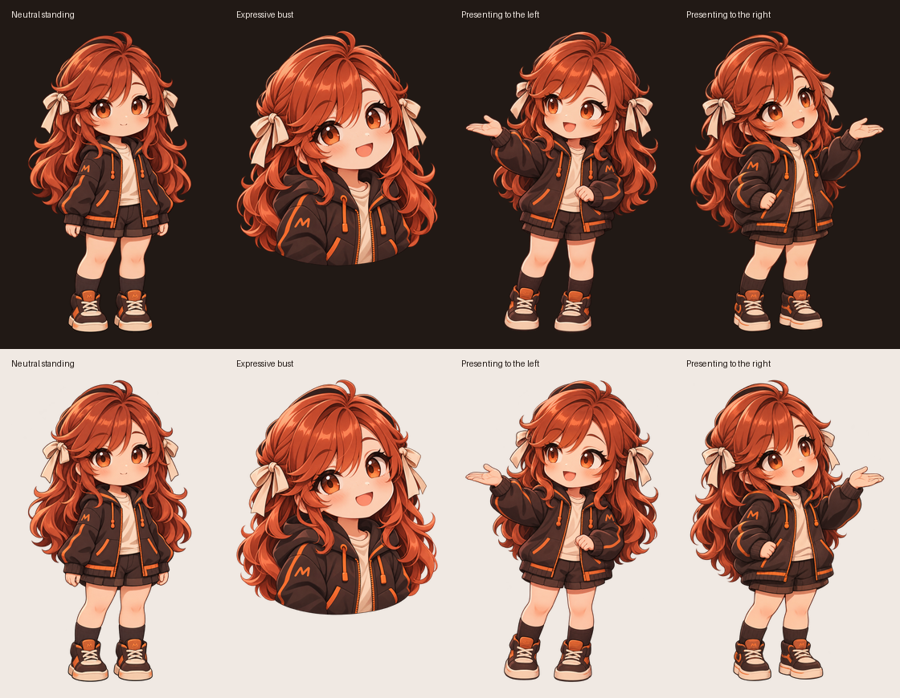

# Nery Mizuki — master artwork kit v3.0

High-resolution artwork for Yuri Cunha's products, sites and presentations.

| Artwork | Native size | Intended placement |
| --- | --- | --- |
| `nery-master-standing` | 1024 × 1536 px | Neutral full-body art for larger layouts |
| `nery-master-bust` | 1158 × 1358 px | Portraits, onboarding and avatars |
| `nery-master-present-left` | 1024 × 1536 px | Nery presents toward copy on the viewer's left |
| `nery-master-present-right` | 1024 × 1536 px | Nery presents toward copy on the viewer's right |

`transparent/` contains the native RGBA PNGs and lossless WebP exports.
The two gestures were drawn independently so the hair part, ribbons and
garment details follow the pose. For print, check the native pixel dimensions
against the intended physical size and print resolution.

`masters/` contains editable OpenRaster files for applications that support
[OpenRaster](https://github.com/openraster/ora-spec). Each file separates the
visible pixels into head, hair and ribbons, clothing and hands, and legs and
shoes where applicable. The areas hidden behind those shapes would need to be
drawn before the parts could be moved independently for animation.



## Provenance and exports

`manifest.json` records the built-in image generation prompts, reference
artwork and native dimensions. `layers.json` records the traced selections
used to assemble the editable files from the transparent originals.

From the repository root, with Pillow installed:

```sh
python scripts/build_master_kit.py
python scripts/build_master_kit.py --check
```

The verification recomposites each OpenRaster file and checks its visible
pixels against the PNG and WebP. The website generates thumbnails and loads
the native WebP when opening the artwork dialog.

Copyright © 2026 Yuri Cunha. All rights reserved under the
[proprietary mascot asset license](../LICENSE.md).
