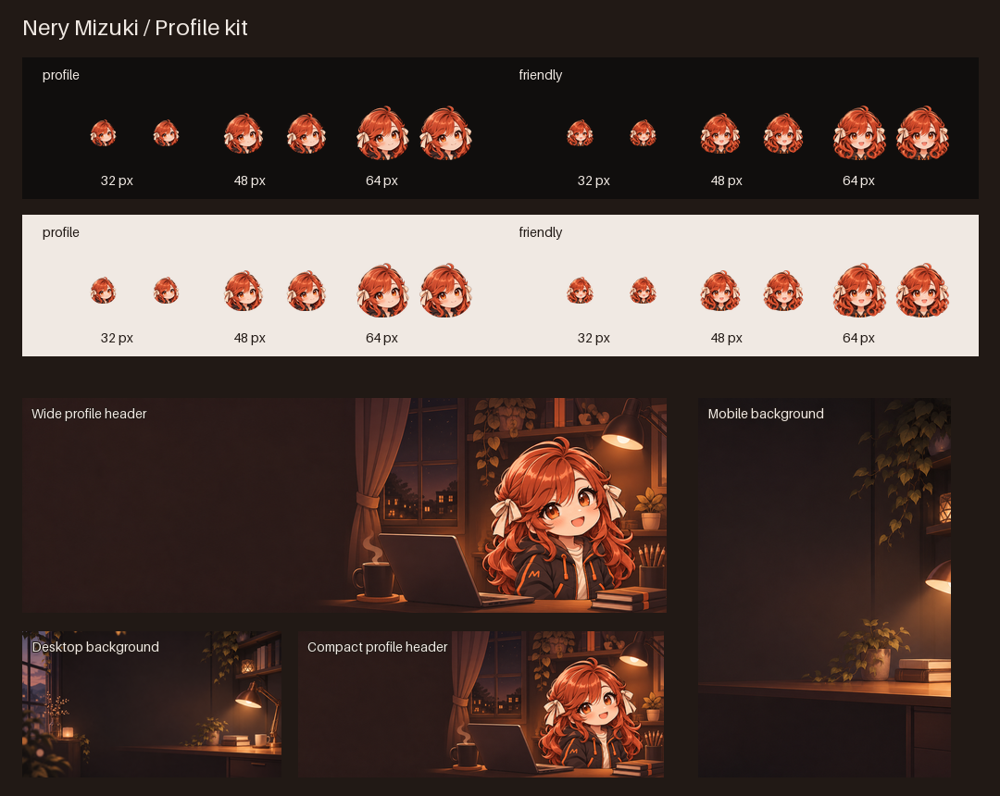

# Nery Mizuki profile kit

A coordinated profile for Yuri Cunha's projects and products. The name,
taglines, bios and suggested status text are in [copy.json](copy.json), in
English and Brazilian Portuguese.

| Placement | Export |
| --- | --- |
| Default avatar | `avatars/profile-512.webp` or `avatars/profile-512.png` |
| Expressive avatar | `avatars/friendly-512.webp` or `avatars/friendly-512.png` |
| Compact views | Transparent PNGs at 32, 48, 64, 128 and 256 px for both expressions |
| X profile avatar and header | `avatars/profile-400.png`, `banners/x.jpg` (1500 × 500) |
| Discord profile header | `banners/discord.png` (600 × 240) |
| GitHub profile avatar | `avatars/profile-512.png` (under 1 MB) |
| GitHub repository social preview | `banners/github.jpg` (1280 × 640, under 1 MB) |
| General profile header | `banners/profile.webp` (1440 × 480) |
| Standalone background | `backgrounds/desktop.webp` (1440 × 810), `backgrounds/mobile.webp` (640 × 960) |

Discord profile banners may require Nitro. The GitHub social preview is a
repository setting. The X header keeps the face and bow away from the
documented top and bottom crop bands. [Discord profile guide](https://support.discord.com/hc/en-us/articles/4409388345495-Per-Server-Profiles) · [GitHub profile guide](https://docs.github.com/en/account-and-profile/reference/profile-reference) · [GitHub social preview guide](https://docs.github.com/en/repositories/managing-your-repositorys-settings-and-features/customizing-your-repository/customizing-your-repositorys-social-media-preview) · [X image guide](https://help.x.com/en/managing-your-account/common-issues-when-uploading-profile-photo)

The [PetDex pack](../../pet/nery/) continues to provide the animated pet
through its existing `pet.json` and spritesheet. Use the profile kit on
surfaces that offer their own avatar, header or background fields.
[PetDex format](https://petdex.dev/docs)



## Build and verify

[manifest.json](manifest.json) records the built-in image generation prompts,
references and crop specifications. `source/` contains the original four
renders. Run these commands from the repository root with Pillow installed:

```sh
python scripts/build_profile_kit.py
python scripts/build_profile_kit.py --check
```

Copyright © 2026 Yuri Cunha. All rights reserved under the
[proprietary mascot asset license](../mascot/LICENSE.md).
